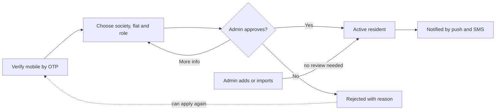

# Resident & Flat Management — Product Requirements Document (PRD)

**Product:** SMART GATE — Multi-Society Residential ERP Platform
**Module:** Resident & Flat Management
**Document ID:** RFM-PRD
**Version:** 1.0 (Draft)
**Date:** 11 November 2026
**Status:** For review
**Related documents:** [README.md](README.md) (start here) · [BRD.md](BRD.md)

> The PRD explains **what the product must do** and **how it should behave**: features, screens, data, permissions, APIs and acceptance criteria. It is written for product, design, engineering and QA. For the business reasons behind each requirement, see BRD.md.

---

## Contents

- [1. Product Overview](#1-product-overview)
- [2. Goals and Non-Goals](#2-goals-and-non-goals)
- [3. Personas](#3-personas)
- [4. User Stories](#4-user-stories)
- [5. Functional Requirements](#5-functional-requirements)
- [6. Workflows](#6-workflows)
- [7. Data Model](#7-data-model)
- [8. Roles and Permissions](#8-roles-and-permissions)
- [9. Bulk Import Specification](#9-bulk-import-specification)
- [10. API Specification](#10-api-specification)
- [11. Non-Functional Requirements](#11-non-functional-requirements)
- [12. Notifications](#12-notifications)
- [13. Reports and Analytics](#13-reports-and-analytics)
- [14. Acceptance Criteria](#14-acceptance-criteria)
- [15. Release Plan](#15-release-plan)
- [16. Open Questions](#16-open-questions)
- [17. Traceability: Business to Product Requirements](#17-traceability-business-to-product-requirements)
- [Glossary](#glossary)

---

## 1. Product Overview

Resident & Flat Management is the master-data module of SMART GATE. It is used by:

- **Admins** on the web portal to build the society structure, load and maintain resident records, and approve new residents.
- **Residents** on the mobile app (and web) to join their society, manage their profile and manage their household.

Other modules read from it:

| Module | Data used |
| --- | --- |
| Visitor & Gate Management | Residents of a flat who receive and approve visitor requests |
| Maintenance & Helpdesk | Flat and resident a complaint belongs to |
| Vendor & Domestic Help | Flats a domestic helper serves |
| Accounting & Finance | Flat as billing unit; area; billing party |
| Amenities & Facility Booking | Eligible residents |
| Vehicle & Parking | Flat a vehicle and slot belong to |
| Communication | Audiences by society, block or flat |
| Facility & Utility | Flat a meter belongs to |
| Reports & Analytics | Occupancy and resident counts |

## 2. Goals and Non-Goals

### Goals

1. A society can go from zero to a complete register in under one working day.
2. Every active resident is verified by mobile OTP and approved by the society.
3. The register stays current through self-service household management and move-out flows.
4. Data is isolated per society and visible only by role.

### Non-goals (this release)

1. KYC or police verification integrations
2. Rental agreement management
3. Resident-to-resident directory or social features
4. Multi-language interface (English only in release 1)

## 3. Personas

| Persona | Description | Main needs |
| --- | --- | --- |
| **Ravi — Society Admin** | Office manager of a 400-flat society; uses a desktop daily | Fast setup, bulk import, clear approvals queue, accurate lists |
| **Meena — Flat Owner** | Owns one flat, lives in it with family | Easy OTP login; add parents and children; control who can approve visitors |
| **Arjun — Landlord Owner** | Owns two flats, rents one out, lives elsewhere | See both flats; add and remove tenants; decide who gets the bill |
| **Sara — Tenant** | Moved in last month on an 11-month lease | Join quickly; add spouse; receive notices and approve visitors |
| **Kumar — Security Supervisor** | Manages guards across shifts | Look up who lives in a flat; no access to sensitive data |
| **Priya — Accountant** | Raises monthly bills | Correct billing party and area for every flat |
| **Platform Super Admin** | Operates SMART GATE across many societies | Create societies; support admins; no data leakage |

## 4. User Stories

### Society structure

| ID | As a… | I want to… | So that… |
| --- | --- | --- | --- |
| US-01 | Society Admin | create blocks with their number of floors | the structure matches the buildings |
| US-02 | Society Admin | generate flats from a numbering pattern | I don't type 400 flats by hand |
| US-03 | Society Admin | edit a flat's type, area and status | billing and reports are correct |
| US-04 | Society Admin | see all flats in a grid coloured by occupancy | I can spot vacant and rented flats at a glance |

### Residents and household

| ID | As a… | I want to… | So that… |
| --- | --- | --- | --- |
| US-05 | Society Admin | add a resident and link them to a flat with a role | the register is complete |
| US-06 | Society Admin | upload an Excel/CSV of flats and residents | I can onboard an existing society quickly |
| US-07 | Society Admin | see import errors row by row | I can fix the file and re-upload |
| US-08 | Owner | add family members to my flat | they can use the app too |
| US-09 | Owner | add or remove a tenant | the society knows who occupies my flat |
| US-10 | Tenant | add my family members | my household can approve visitors |
| US-11 | Owner of two flats | switch between my flats in the app | I can manage each separately |
| US-12 | Resident | update my photo, email and emergency contact | the society has current details |

### Onboarding and approval

| ID | As a… | I want to… | So that… |
| --- | --- | --- | --- |
| US-13 | New resident | sign up with my mobile number and OTP and choose my flat | I can request access without visiting the office |
| US-14 | New resident | see the status of my request | I know when I can start using the app |
| US-15 | Society Admin | see pending requests with the flat's current residents | I can verify before approving |
| US-16 | Society Admin | approve or reject with a reason | the resident knows the outcome |

### Move-out and history

| ID | As a… | I want to… | So that… |
| --- | --- | --- | --- |
| US-17 | Society Admin / Owner | record a tenant's move-out | their access ends and the flat status updates |
| US-18 | Society Admin | record a change of owner | the new owner gets access and history is kept |
| US-19 | Society Admin | search past residents | I can answer gate or billing queries about them |

### Directory and security

| ID | As a… | I want to… | So that… |
| --- | --- | --- | --- |
| US-20 | Security Supervisor | look up residents of a flat with name and photo | I can verify people at the gate |
| US-21 | Society Admin | export the resident list to Excel/PDF | I can share it with the committee |
| US-22 | Society Admin | see who changed a record and when | I can trace mistakes |

## 5. Functional Requirements

Priority: **P0** = must have for launch, **P1** = should have, **P2** = could have.

### 5.1 Society Structure

| ID | Requirement | Priority |
| --- | --- | --- |
| FR-01 | Admin can create, edit and deactivate blocks with name/code, number of floors and description. | P0 |
| FR-02 | Floors are generated from the block's floor count; labels support G (ground) and basement levels (B1, B2). | P0 |
| FR-03 | Admin can create, edit and deactivate flats with flat number, floor, type, area (sq ft) and status. | P0 |
| FR-04 | Admin can bulk-generate flats from a pattern (floor range, flats per floor, numbering format). | P1 |
| FR-05 | Flat types are configurable per society (e.g. 1BHK, 2BHK, 3BHK, Villa, Shop). | P1 |
| FR-06 | Occupancy status (Vacant, Owner-occupied, Rented, Locked) updates automatically on approval and move-out; admin can override. | P0 |
| FR-07 | Society view shows a block/floor tree and a flat grid coloured by occupancy, with counts per status. | P1 |
| FR-08 | Blocks, floors or flats with residents or history cannot be deleted, only deactivated. | P0 |

### 5.2 Resident Records

| ID | Requirement | Priority |
| --- | --- | --- |
| FR-09 | Admin can add a resident with name, mobile, email, type, linked flat(s), photo and emergency contact. | P0 |
| FR-10 | A resident can be linked to multiple flats, with a role (Owner, Tenant, Family) in each. | P0 |
| FR-11 | Each occupied flat has exactly one primary contact. | P0 |
| FR-12 | Tenant links record move-in date and optional lease end date. | P0 |
| FR-13 | Optional ID proof (type, number, document upload) per resident. | P1 |
| FR-14 | Each flat records the billing party: Owner or Tenant. | P1 |
| FR-15 | Resident list supports search (name, mobile, flat) and filters (block, type, status). | P0 |
| FR-16 | Resident list exports to Excel and PDF. | P1 |
| FR-17 | Resident profile page shows linked flats, household, status history and audit trail. | P1 |

### 5.3 Household Management (Resident App and Web)

| ID | Requirement | Priority |
| --- | --- | --- |
| FR-18 | Owner can add, edit and remove family members for their flat. | P0 |
| FR-19 | Owner can add a tenant (sends an invite and creates an approval request) and record a tenant's move-out. | P0 |
| FR-20 | Tenant can add, edit and remove their own family members. | P1 |
| FR-21 | Family members added by an active owner or tenant become Active without admin approval (configurable per society). | P1 |
| FR-22 | Residents linked to more than one flat can switch the active flat in the app. | P1 |
| FR-23 | Resident can edit own photo, email and emergency contact; mobile number change requires OTP on the new number. | P0 |

### 5.4 Bulk Import

| ID | Requirement | Priority |
| --- | --- | --- |
| FR-24 | Admin can download an import template (.xlsx and .csv). | P0 |
| FR-25 | Admin can upload a filled file; the system validates every row before import. | P0 |
| FR-26 | A preview shows rows ready, rows with warnings and rows with errors, with reasons. | P0 |
| FR-27 | Admin can import valid rows only, or cancel, fix and re-upload. | P0 |
| FR-28 | Import creates missing blocks, floors and flats, then residents and their flat links. | P0 |
| FR-29 | An error report (row number, column, reason) is downloadable. | P0 |
| FR-30 | Import history lists every upload with uploader, time and counts. | P1 |
| FR-31 | Option to send an SMS app invitation to imported residents. | P2 |

### 5.5 Onboarding and Approval

| ID | Requirement | Priority |
| --- | --- | --- |
| FR-32 | New user can log in with mobile number and OTP. | P0 |
| FR-33 | Unregistered user can select society, block, flat and role (Owner/Tenant) and submit a join request. | P0 |
| FR-34 | Join request status (Pending, Approved, Rejected, More info needed) is visible to the requester. | P0 |
| FR-35 | Admin has an Approvals queue with request details, the flat's current residents and conflict warnings (e.g. a second owner claim, an existing tenant). | P0 |
| FR-36 | Admin can approve, reject with a reason, or ask for more information. | P0 |
| FR-37 | Requester is notified of the decision by push and SMS. | P0 |
| FR-38 | Dashboard shows the count of pending requests; admin receives a daily reminder if any are older than 24 hours. | P1 |

### 5.6 Move-Out and Transfer

| ID | Requirement | Priority |
| --- | --- | --- |
| FR-39 | Admin or owner can record a tenant move-out with date; tenant and their family become Moved out. | P0 |
| FR-40 | Admin can record a change of ownership: old owner(s) moved out, new owner added; flat dues stay on the flat. | P1 |
| FR-41 | On move-out, app access for that flat ends immediately and the primary contact is reassigned. | P0 |
| FR-42 | Past residents remain searchable with their dates of stay. | P1 |
| FR-43 | Lease-end reminder to owner and admin 30 days before the lease end date. | P2 |

### 5.7 Security and Audit

| ID | Requirement | Priority |
| --- | --- | --- |
| FR-44 | Every record carries a society ID; every API request is filtered by the user's society on the server. | P0 |
| FR-45 | Access is checked by role on the server for every action (see section 8). | P0 |
| FR-46 | Mobile numbers are masked for guard and supervisor roles. | P0 |
| FR-47 | All creates, updates, approvals, rejections, imports and move-outs are written to the audit log with user, time, old and new values. | P0 |

## 6. Workflows

### 6.1 Resident onboarding

### 6.2 Owner adds a tenant

1. Owner opens **My Household → Add tenant**, enters name, mobile and move-in date.
2. System sends the tenant an SMS invite and creates a request in the Approvals queue.
3. Admin approves; flat status changes to **Rented**; billing party is set per society default.
4. Tenant logs in with OTP and can add family members.

### 6.3 Tenant move-out

1. Owner or admin selects the tenant and chooses **Record move-out** with a date.
2. Tenant and their family are marked **Moved out**; app access for the flat ends.
3. Primary contact returns to the owner; flat status becomes **Owner-occupied** or **Vacant**.
4. The event is logged; history stays searchable.

### 6.4 Bulk import

1. Download template → fill → upload.
2. Validate and preview (ready / warning / error).
3. Import valid rows or fix and re-upload.
4. Structure and residents created; summary and error report saved to import history.

### 6.5 Resident status lifecycle

| Status | Meaning | Can log in |
| --- | --- | --- |
| Pending | Join request awaiting admin review | Request status only |
| Active | Approved resident | Yes |
| Rejected | Request declined; may reapply | No |
| Inactive | Suspended by admin | No |
| Moved out | No longer living in the flat | No (for that flat) |

## 7. Data Model

All tables include `society_id`, `created_at`, `updated_at`, `created_by` and `updated_by`.

| Table | Key fields | Notes |
| --- | --- | --- |
| `societies` | id, name, address, city, status | Created by Super Admin |
| `blocks` | id, society_id, name, floor_count, is_active | Unique (society_id, name) |
| `floors` | id, block_id, floor_number, label | G, 1, 2 … B1, B2 |
| `flats` | id, block_id, floor_id, flat_number, flat_type, area_sqft, occupancy_status, billing_party, is_active | Unique (block_id, flat_number) |
| `residents` | id, full_name, mobile, email, photo_url, id_proof_type, id_proof_number, id_proof_url, emergency_name, emergency_mobile, status | Unique (society_id, mobile) |
| `flat_residents` | id, flat_id, resident_id, role, is_primary, move_in_date, move_out_date, lease_end_date, status | Many-to-many; keeps history |
| `resident_requests` | id, flat_id, resident_id, requested_role, source (self / owner_invite), status, reviewed_by, reviewed_at, reason | Approvals queue |
| `import_jobs` | id, file_name, uploaded_by, total_rows, success_rows, error_rows, error_report_url, status | Import history |
| `audit_logs` | id, entity, entity_id, action, user_id, old_value, new_value, timestamp | Platform-wide |

**Relationships:** society 1—n blocks 1—n floors 1—n flats; flats n—n residents through `flat_residents`.

## 8. Roles and Permissions

| Action | Super Admin | Society Admin | Accountant | Security Supervisor | Owner | Tenant | Family |
| --- | --- | --- | --- | --- | --- | --- | --- |
| Create society | Yes | — | — | — | — | — | — |
| Manage blocks, floors, flats | Yes | Yes | — | — | — | — | — |
| Add / edit residents | Yes | Yes | — | — | Own flat | Own flat | — |
| Bulk import | Yes | Yes | — | — | — | — | — |
| Approve / reject requests | Yes | Yes | — | — | — | — | — |
| Add family member | Yes | Yes | — | — | Yes | Yes | — |
| Add / remove tenant | Yes | Yes | — | — | Yes | — | — |
| View directory | Yes | Yes | View | Name, flat, photo | Own flat | Own flat | Own flat |
| View mobile numbers | Yes | Yes | Yes | Masked | Own flat | Own flat | Own flat |
| Export resident list | Yes | Yes | Yes | — | — | — | — |
| Record move-out | Yes | Yes | — | — | Own tenant | — | — |
| View audit log | Yes | Yes | — | — | — | — | — |

## 9. Bulk Import Specification

One row per resident per flat. A row with flat columns only creates the flat.

| Column | Required | Example | Validation |
| --- | --- | --- | --- |
| block | Yes | A | Created if new |
| floor | Yes | 3 | Number, G, B1, B2 |
| flat_number | Yes | A-302 | Unique within block |
| flat_type | No | 2BHK | Must be in society's type list |
| area_sqft | No | 1150 | Positive number |
| resident_name | If resident | Priya Sharma | 2–100 characters |
| mobile | If resident | 9876543210 | 10 digits; unique in society |
| email | No | priya@example.com | Valid email format |
| resident_type | If resident | Owner | Owner, Tenant or Family |
| is_primary | No | Yes | Yes/No; one per flat |
| move_in_date | For tenants | 01-04-2026 | DD-MM-YYYY or YYYY-MM-DD |
| billing_party | No | Owner | Owner or Tenant |

**Error handling:** rows with errors are skipped and listed with row number, column and reason. Duplicate mobile numbers within the file or against existing records are flagged as errors. Limits: up to 5,000 rows and 5 MB per file.

## 10. API Specification

Versioned REST APIs under `/api/v1`, shared by web and mobile, authenticated with JWT and documented in Swagger/Postman.

| Method | Endpoint | Purpose | Access |
| --- | --- | --- | --- |
| GET / POST | `/blocks` | List or create blocks | Admin |
| PUT / PATCH | `/blocks/{id}` | Edit or deactivate | Admin |
| GET / POST | `/flats` | List (filter by block, floor, status) or create | Admin; read for staff |
| POST | `/flats/bulk-generate` | Create flats from a pattern | Admin |
| GET / PUT | `/flats/{id}` | Flat details with occupants; edit | Admin; own flat read |
| GET / POST | `/residents` | Search or add residents | Admin |
| GET / PUT | `/residents/{id}` | Profile; edit | Admin; self |
| POST | `/flats/{id}/residents` | Link a resident to a flat with a role | Admin, Owner, Tenant |
| POST | `/flat-residents/{id}/move-out` | Record move-out | Admin, Owner |
| POST | `/flats/{id}/transfer-ownership` | Change of owner | Admin |
| POST | `/auth/otp/send`, `/auth/otp/verify` | OTP login | Public |
| POST | `/resident-requests` | Submit join request | Verified mobile |
| GET | `/resident-requests?status=pending` | Approvals queue | Admin |
| POST | `/resident-requests/{id}/approve` · `/reject` · `/request-info` | Decide | Admin |
| POST | `/imports` | Upload and validate | Admin |
| POST | `/imports/{id}/confirm` | Import valid rows | Admin |
| GET | `/imports/{id}/errors` | Error report | Admin |
| GET | `/me/household` | Current user's flats and household | Resident |
| GET | `/residents/export?format=xlsx|pdf` | Export | Admin, Accountant |

## 11. Non-Functional Requirements

| Category | Requirement |
| --- | --- |
| Performance | List and search screens respond within 2 seconds for societies up to 5,000 flats; a 1,000-row import validates within 60 seconds. |
| Scalability | Supports hundreds of societies on one deployment with no cross-society slowdown. |
| Security | HTTPS everywhere; JWT with expiry and refresh; passwords hashed; server-side role and society checks; input validation; rate limiting on OTP and login. |
| OTP | 6 digits, valid 5 minutes, 3 attempts, 30-second resend wait. |
| Privacy | Personal data visible only by role; mobile masking for guards; data export and deletion on valid request, in line with the DPDP Act, 2023. |
| Auditability | All changes logged and retained for at least 3 years. |
| Availability | 99.5% monthly uptime; daily backups. |
| Usability | Responsive web portal (desktop, tablet, mobile browser); key app tasks in 3 taps or fewer. |
| Compatibility | Android 8+ and iOS 14+; latest two versions of Chrome, Edge, Safari and Firefox. |
| Accessibility | Readable contrast, labelled form fields, scalable text. |

## 12. Notifications

| Event | Recipient | Channel |
| --- | --- | --- |
| OTP requested | User | SMS |
| Join request submitted | Society Admin | Push, in-portal |
| Request approved / rejected / more info | Requester | Push, SMS |
| Tenant invited by owner | Tenant | SMS |
| Added as family member | Family member | SMS |
| Move-out recorded | Affected residents, owner | Push |
| Pending requests older than 24 hours | Society Admin | Push, email |
| Lease ends in 30 days | Owner, Society Admin | Push |
| Import completed | Uploading admin | In-portal, email |

## 13. Reports and Analytics

| Report | Content |
| --- | --- |
| Occupancy summary | Flats by status per block; vacant and rented counts |
| Resident summary | Residents by type and status |
| Pending approvals | Requests by age |
| App adoption | Flats with at least one logged-in resident |
| Move-in / move-out log | Events by date range |
| Data completeness | Residents missing email, photo or emergency contact |

All reports export to Excel and PDF.

## 14. Acceptance Criteria

- [ ] Admin can create a society structure of 10 blocks and 400 flats, including by bulk generation.
- [ ] An import file with valid and invalid rows produces a correct preview, imports only valid rows and offers an error report.
- [ ] A self sign-up appears in the Approvals queue; approval activates the resident and notifies them by push and SMS.
- [ ] A rejected requester sees the reason and can reapply.
- [ ] An owner can add family members and a tenant; a tenant can add family members.
- [ ] Recording a tenant move-out ends their app access immediately and updates flat status and primary contact.
- [ ] Each role can perform only the actions in section 8, verified for every role.
- [ ] A user of Society A cannot read or change any record of Society B, through the app or the API.
- [ ] Guard roles never see full mobile numbers.
- [ ] Every change appears in the audit log with user, time, old and new values.
- [ ] Occupancy and resident counts in reports match the underlying records.
- [ ] No critical or high-severity defects open.

## 15. Release Plan

| Phase | Scope |
| --- | --- |
| Phase 1 — Foundation | Society structure, resident records, admin add/edit, bulk import, OTP login, approvals queue, audit log, role and society isolation |
| Phase 2 — Resident self-service | Resident app: join request, profile, household (family, tenants), multi-flat switch, notifications |
| Phase 3 — Lifecycle and insight | Move-out and ownership transfer, past residents, lease reminders, reports, SMS invitations |

## 16. Open Questions

| # | Question | Owner |
| --- | --- | --- |
| 1 | Can family members added by an active resident skip admin approval, or should each society choose? | Client |
| 2 | For rented flats, does the owner or the tenant receive maintenance bills by default? | Client |
| 3 | Is ID proof mandatory for tenants? | Client |
| 4 | Should guards see resident photos only, or also names? | Client |
| 5 | Which flat types and floor labels does the pilot society use? | Client |
| 6 | Should imported residents automatically receive an SMS invitation? | Client |
| 7 | Retention period for moved-out residents' personal data? | Client / Legal |

## 17. Traceability: Business to Product Requirements

Every functional requirement traces back to a business requirement in [BRD.md](BRD.md). When you change one, check the other.

| Business requirement | Functional requirements |
| --- | --- |
| BR-01 Society structure | FR-01 – FR-05, FR-08 |
| BR-02 Occupancy status | FR-06, FR-07 |
| BR-03 Owners, tenants, family | FR-09, FR-12, FR-18 – FR-20 |
| BR-04 One person, many flats | FR-10, FR-22 |
| BR-05 Primary contact | FR-11, FR-41 |
| BR-06 Bulk import | FR-24 – FR-31 |
| BR-07 Self sign-up | FR-32 – FR-34 |
| BR-08 Approval before access | FR-35 – FR-38 |
| BR-09 Owner adds family and tenants | FR-18, FR-19 |
| BR-10 Tenant adds family | FR-20, FR-21 |
| BR-11 Move-out and transfer with history | FR-39 – FR-42 |
| BR-12 Society data isolation | FR-44 |
| BR-13 Role-based access | FR-45, FR-46 |
| BR-14 Audit trail | FR-47 |
| BR-15 Search and export | FR-15, FR-16 |
| BR-16 Billing party | FR-14 |
| BR-17 Lease-end reminder | FR-43 |

## Glossary

| Term | Meaning |
| --- | --- |
| Society | A residential complex managed as one unit on the platform |
| Block | A tower, wing or building within a society |
| Flat | A residential or commercial unit within a block |
| Owner | Person who owns a flat |
| Tenant | Person renting a flat for a period |
| Family member | Person living with an owner or tenant household |
| Primary contact | The resident who receives approvals and communication for a flat first |
| Billing party | Owner or tenant who receives the maintenance bill |
| Occupancy status | Vacant, Owner-occupied, Rented or Locked |
| OTP | One-time password sent by SMS for login |
| DLT | Distributed Ledger Technology registration required for commercial SMS in India |
| DPDP Act | Digital Personal Data Protection Act, 2023 (India) |
| Society isolation | Guarantee that one society's data is never accessible to another |

---

## Document History

| Version | Date | Author | Change |
| --- | --- | --- | --- |
| 1.0 | 11-11-2026 | Product team | First draft |
